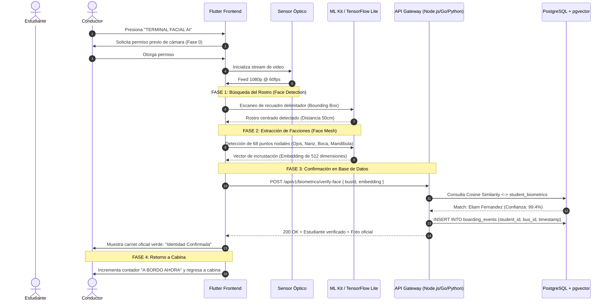

# 🛰️ Terminal Facial AI (Check-in de Abordaje Estudiantil)
## Especificación de Arquitectura e Integración Frontend ⟷ Backend & Base de Datos

---

## 1. Resumen Ejecutivo
El módulo **Terminal Facial AI (Abordaje)** permite a los conductores de autobuses escolares certificar el ascenso y descenso seguro de los estudiantes en tiempo real mediante reconocimiento biométrico facial. 

Este documento detalla la arquitectura técnica, los contratos de API y el esquema de base de datos para la transición del prototipo frontend interactivo a producción.

---

## 2. Pipeline Biométrico en 4 Fases



---

## 3. Modelo de Base de Datos (PostgreSQL + pgvector)

Para almacenar y consultar los vectores biométricos faciales de alta velocidad se recomienda la extensión **`pgvector`** de PostgreSQL:

```sql
-- 1. Habilitar extensión vectorial
CREATE EXTENSION IF NOT EXISTS vector;

-- 2. Tabla de Credenciales Biométricas del Estudiante
CREATE TABLE student_biometrics (
    id SERIAL PRIMARY KEY,
    student_id INT NOT NULL REFERENCES students(id) ON DELETE CASCADE,
    photo_url VARCHAR(500) NOT NULL,
    embedding vector(512) NOT NULL, -- Vector de 512 floats generado por FaceNet / InsightFace
    is_active BOOLEAN DEFAULT TRUE,
    created_at TIMESTAMP WITH TIME ZONE DEFAULT CURRENT_TIMESTAMP,
    updated_at TIMESTAMP WITH TIME ZONE DEFAULT CURRENT_TIMESTAMP
);

-- Índice vectorial para búsqueda en < 5 milisegundos
CREATE INDEX idx_student_biometrics_embedding 
ON student_biometrics USING ivfflat (embedding vector_cosine_ops)
WITH (lists = 100);

-- 3. Tabla de Registro de Abordajes (Check-in Log)
CREATE TABLE boarding_events (
    id UUID PRIMARY KEY DEFAULT gen_random_uuid(),
    student_id INT NOT NULL REFERENCES students(id),
    bus_code VARCHAR(50) NOT NULL,
    route_code VARCHAR(50) NOT NULL,
    stop_id INT REFERENCES stops(id),
    method VARCHAR(50) DEFAULT 'Biometría Facial AI',
    confidence_score NUMERIC(5,2) NOT NULL, -- ej. 99.40
    latitude NUMERIC(10, 7),
    longitude NUMERIC(10, 7),
    created_at TIMESTAMP WITH TIME ZONE DEFAULT CURRENT_TIMESTAMP
);
```

---

## 4. Contratos de API RESTful / OpenAPI

### `POST /api/v1/biometrics/verify-face`
Comprueba la imagen o el vector facial capturado por la cámara contra los estudiantes asignados a la ruta del autobús.

#### Request (Multipart o JSON):
```json
{
  "busCode": "BUS-01",
  "routeCode": "R-UB",
  "currentLatitude": 8.5242,
  "currentLongitude": -80.3522,
  "faceEmbedding": [0.0245, -0.1192, 0.4501, "...512 floats..."]
}
```

#### Response Exitosa (`200 OK`):
```json
{
  "success": true,
  "match": true,
  "confidence": 0.994,
  "student": {
    "id": 5,
    "studentCode": "EST-2024-8891",
    "name": "Eliam Fernandez",
    "schoolName": "Colegio San José",
    "grade": "4to Grado Primaria",
    "photoUrl": "https://cdn.smartroute.pa/photos/eliam_student.png",
    "parentName": "Elena Fernández",
    "parentPhone": "+507 6712-3490",
    "status": "onboard",
    "boardingTime": "07:05:32 AM"
  },
  "bus": {
    "code": "BUS-01",
    "seatsOccupied": 15,
    "capacity": 16
  }
}
```

---

## 5. Implementación en Flutter (Cómo conectar el Frontend)

En [`facial_checkin_screen.dart`](file:///c:/Users/VICTUS15FB/Downloads/SmartRoute-1-main%20%281%29/SmartRoute-1-main/lib/modulos/conductor/vistas/facial_checkin_screen.dart), el bloque simulado de la Fase 3 se reemplaza por la llamada HTTP real:

```dart
// En _FacialCheckinScreenState:
Future<void> _verifyFaceWithBackend(List<double> embedding) async {
  try {
    final response = await http.post(
      Uri.parse('https://api.smartroute.pa/v1/biometrics/verify-face'),
      headers: {'Content-Type': 'application/json', 'Authorization': 'Bearer $jwtToken'},
      body: jsonEncode({
        'busCode': 'BUS-01',
        'faceEmbedding': embedding,
      }),
    );

    if (response.statusCode == 200) {
      final data = jsonDecode(response.body);
      if (data['match'] == true) {
        setState(() {
          _currentPhase = 3;
          _matchingConfidence = data['confidence'];
        });
      }
    }
  } catch (e) {
    // Manejo de error de conexión / fallback a check-in manual
  }
}
```

---

## 6. Privacidad y Protección de Datos de Menores
- **Cifrado en tránsito y reposo**: Los datos biométricos se cifran con **AES-256-GCM**.
- **No almacenamiento de imágenes crudas**: El sistema almacena únicamente la incrustación vectorial numérica (Embedding) irreversible, nunca el feed de video continuo.
- **Cumplimiento legal**: Conforme a la **Ley 81 de Protección de Datos Personales de Panamá** y estándares internacionales COPPA / GDPR-K.
